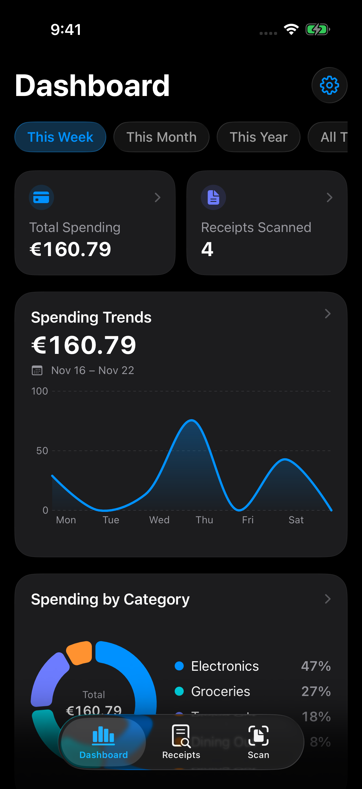
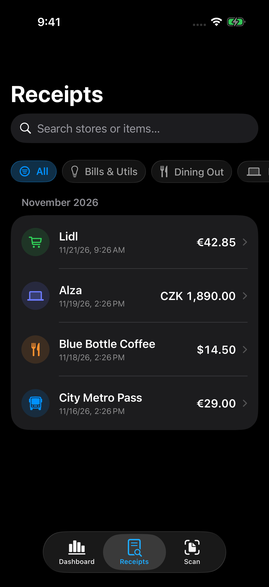
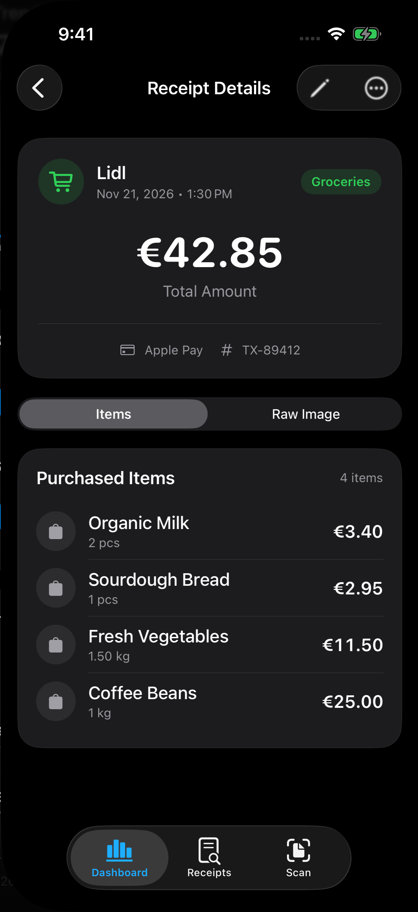
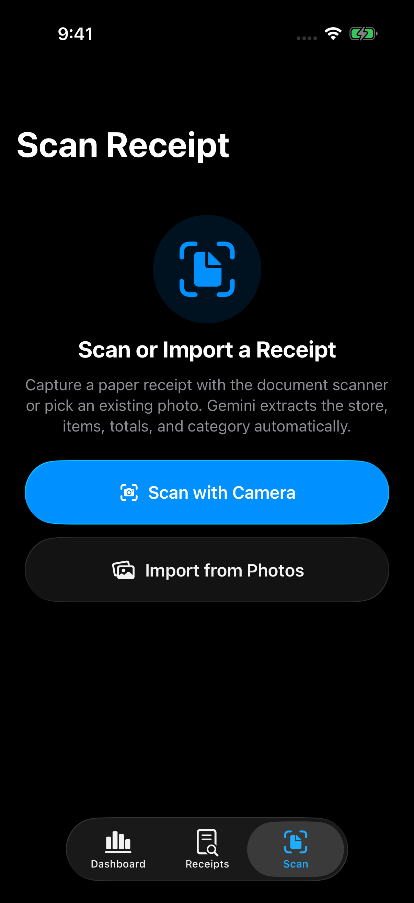

# Receipts

**Receipts** is a native iOS application designed to help you manage and organize your receipts with ease — the SwiftUI port of [ReceiptsTracker](https://github.com/OnDroo/ReceiptsTracker). Leveraging the power of the Google Gemini API, it automatically extracts store details, line items, totals, and categories so you can track spending and find any receipt by its content.

## Features

* **Receipt Management**: Store and organize all your receipts in one place. Scan paper receipts with the VisionKit document scanner or import existing photos, and the app will handle the rest.
* **Spending Dashboard**: View spending trends and category breakdowns with native Swift Charts across weekly, monthly, yearly, and all-time ranges.
* **Search & Filtering**: Search receipts by store name or purchased items and filter by category.
* **Customizable Settings**:
  * Set your preferred currency (EUR, USD, CZK, etc.) with automatic conversion.
  * Choose your preferred AI Model (e.g., `gemini-4-hydrogen`) and refresh available models from Gemini.
  * API key is stored securely in the iOS Keychain.
* **Shortcuts & Siri (`AppIntents`)**: Check your monthly spending summary or jump straight into the receipt scanner from Apple Shortcuts, Siri, or the Action Button.
* **Native iOS Design**: Built with SwiftUI, iOS 26 Liquid Glass, and adaptive layouts for iPhone, iPhone Duo, and iPad.

## Screenshots

| Dashboard | Search | Receipt Details | Scanner |
|:---:|:---:|:---:|:---:|
|  |  |  |  |

## Setup & Configuration

This application requires a Google Gemini API Key to scan and analyze receipts.

### 1. Get a Free API Key
1. Go to [Google AI Studio](https://aistudio.google.com/).
2. Sign in with your Google account.
3. Click on **"Get API key"** to create a free API key.

### 2. Configure the App
1. Open the **Receipts** app on your iPhone or iPad.
2. Tap the **Settings** button on the top-right of the **Dashboard**.
3. Enter your API Key in the **Gemini API Key** field.
4. (Optional) Select your preferred **AI Model** and **Currency**.

## Opening in Xcode (macOS)

This repository uses [XcodeGen](https://github.com/yonaskolb/XcodeGen) to generate `ReceiptsTracker.xcodeproj` from `project.yml`.

### Option 1: Using Homebrew (Recommended)

```bash
brew install xcodegen
xcodegen generate
open ReceiptsTracker.xcodeproj
```

#### Troubleshooting `zsh: command not found: brew`
1. **Check if Homebrew is already installed on Apple Silicon (just missing from `PATH`):**
   ```bash
   /opt/homebrew/bin/brew --version
   ```
   If that prints a version number, load it into your shell and run `xcodegen`:
   ```bash
   eval "$(/opt/homebrew/bin/brew shellenv)"
   brew install xcodegen
   xcodegen generate
   open ReceiptsTracker.xcodeproj
   ```
2. **If Homebrew is not installed yet** (requires macOS admin password):
   ```bash
   /bin/bash -c "$(curl -fsSL https://raw.githubusercontent.com/Homebrew/install/HEAD/install.sh)"
   ```
   Follow the `eval "$(/opt/homebrew/bin/brew shellenv)"` instructions printed at the end, then run the `brew install xcodegen` commands above.

### Option 2: Without Homebrew (No Admin Password Needed)

Useful on school or lab Macs where Homebrew cannot be installed. Run these commands from the repository root:

```bash
curl -L https://github.com/yonaskolb/XcodeGen/releases/latest/download/xcodegen.artifactbundle.zip -o /tmp/xcodegen.zip
unzip -o /tmp/xcodegen.zip -d /tmp/xcodegen
/tmp/xcodegen/xcodegen.artifactbundle/xcodegen-*/bin/xcodegen generate
open ReceiptsTracker.xcodeproj
```

> If macOS Gatekeeper blocks the downloaded binary, clear the quarantine attribute once and re-run the `generate` command:
> ```bash
> xattr -dr com.apple.quarantine /tmp/xcodegen
> ```

### Running the App
Once `ReceiptsTracker.xcodeproj` opens in Xcode, select an iPhone or iPad Simulator in the top toolbar and press **Cmd + R** (or pass `--demo-data` as a launch argument in the scheme to launch with seeded sample receipts).

## Built With
* [Swift](https://www.swift.org/) & [SwiftUI](https://developer.apple.com/xcode/swiftui/) (iOS 26 Liquid Glass)
* [SwiftData](https://developer.apple.com/xcode/swiftdata/) & [Swift Charts](https://developer.apple.com/documentation/charts)
* [VisionKit](https://developer.apple.com/documentation/visionkit)
* [Google Gemini API](https://ai.google.dev/)